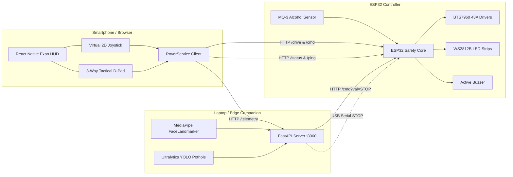

# 🚗 Smart Driver Assistance System (SDAS)

[](https://github.com)
[](https://www.espressif.com/en/products/socs/esp32)
[](https://fastapi.tiangolo.com)
[](https://developers.google.com/mediapipe)
[](https://expo.dev)
[](LICENSE)

An integrated, end-to-end autonomous safety and driver assistance robotics platform combining **ESP32 microcontroller firmware**, **computer vision driver monitoring (MediaPipe & YOLO)**, and a **Cyberpunk-styled React Native Expo mobile cockpit**.

---

## 📌 Table of Contents
1. [Project Overview](#-project-overview)
2. [Problem Statement](#-problem-statement)
3. [Key Safety Features](#-key-safety-features)
4. [System Architecture](#-system-architecture)
5. [Repository Structure](#-repository-structure)
6. [Technology Stack](#-technology-stack)
7. [Hardware Requirements & Pinout](#-hardware-requirements--pinout)
8. [Installation & Setup](#-installation--setup)
9. [Running the Components](#-running-the-components)
10. [Visual Assets & Project Evidence](#-visual-assets--project-evidence)
11. [Troubleshooting](#-troubleshooting)
12. [Future Enhancements](#-future-enhancements)

---

## 🌟 Project Overview

The **Smart Driver Assistance System** is an academic robotics and AI project designed to demonstrate proactive vehicular safety interventions. Rather than merely alerting a driver with audio beeps or passively recording road events, this system combines **environmental awareness**, **physiological vigilance tracking**, and **active vehicle powertrain intervention**.

When an unsafe condition arises—whether the driver falls asleep at the wheel, is impaired by alcohol, or encounters roadway hazards—the system intervenes directly at the embedded powertrain layer by **floating the MOSFET motor driver gates** and executing an **autonomous 3-phase auto-parking trajectory** to maneuver the vehicle safely to the curb.

```
       [ Driver Facial Vigilance ]   ──┐
       [ Alcohol Gas Concentration]  ──┼──> [ Multi-Layer Safety Engine ] ──> [ Physical Powertrain Intervention ]
       [ Forward Road Potholes ]     ──┘
```

---

## ⚠️ Problem Statement

According to global transportation safety statistics from the World Health Organization (WHO) and NHTSA:
* **Driver Drowsiness & Microsleep**: Fatigue causes over 100,000 police-reported crashes annually. A 2-second microsleep episode at 60 mph means travelling over 175 feet completely blind without vehicle control.
* **Driving Under the Influence (DUI)**: Alcohol impairment remains a leading cause of fatal vehicular collisions worldwide, frequently occurring when impaired individuals attempt to operate ignition switches.
* **Road Infrastructure Anomalies**: Undetected potholes and structural road cracks cause severe suspension damage, tire blowouts, and secondary loss-of-control accidents.

Traditional Advanced Driver Assistance Systems (ADAS) are often siloed, high-cost, or confined to premium vehicles. The Smart Driver Assistance System demonstrates a functional, open-architecture prototype integrating AI edge computing, real-time wireless telemetry, and physical fail-safe interlocks.

---

## 🛡️ Key Safety Features

* 🍺 **MQ-3 Breath Alcohol Ignition Lockout**: Continuously monitors alcohol vapors in the cabin. Implements exponential moving-average noise filtering and a 4-strike consecutive threshold debounce. Exceeding `ALCOHOL_THRESH (3000)` instantly floats the motor driver gates and sounds the onboard alarm.
* 😴 **AI Drowsiness & Microsleep Intervention**: A camera-based AI pipeline tracks 478 3D facial landmarks using **MediaPipe FaceLandmarker**. Measures Eye Aspect Ratio (EAR) and Mouth Aspect Ratio (MAR). Eye closure $\ge 2.0\text{s}$ triggers critical emergency stop dispatch across both Wi-Fi HTTP and USB Serial.
* 🕳️ **YOLO-Powered Road Hazard Detection**: Scans the roadway ahead using custom-trained **YOLOv8** weights (`pothole_best.pt`) and YOLO11 nano to log potholes and surface hazards.
* 🅿️ **3-Phase Autonomous Safety Parking Trajectory**: Upon receiving an emergency halt command, the ESP32 executes an autonomous curved safety pull-over:
  1. *Phase 1 (1.6s)*: Arcs left toward the road shoulder.
  2. *Phase 2 (1.0s)*: Reverses parallel to the curb.
  3. *Phase 3 (0.6s)*: Soft deceleration to a complete halt and enters `STATE_HALTED`.
* ⚡ **Hardware Gate Isolation Cutoff**: Floats the MOSFET gates on dual BTS7960 43A motor drivers by pulling enable pins (`R_EN`, `L_EN`) `LOW`, physically terminating current draw.
* ⏱️ **850ms Fail-Safe Watchdog**: Halts motor drive automatically if Wi-Fi packets drop or the mobile app goes out of range for more than 850 milliseconds.
* 📱 **Cyberpunk Mobile Cockpit HUD**: A dedicated touch-based controller built with React Native Expo featuring an 8-way Tactical D-Pad, 2D proportional virtual joystick, speed presets (`ECO`, `MID`, `SPORT`), and real-time DMS AI telemetry streaming.

---

## 🏗️ System Architecture

The project operates across a coordinated three-tier distributed architecture over a common Wi-Fi local area network:



For complete technical specifications on the finite state machine, timing diagrams, and protocol details, see the dedicated [Architecture Documentation](documentation/architecture.md).

---

## 📁 Repository Structure

```text
Smart-Driver-Assistance-System/
├── firmware/                              # Component 1: Embedded ESP32 Controller
│   ├── esp32_rover/
│   │   └── esp32_rover.ino               # Main Arduino C++ firmware (FSM, PWM, REST, UDP)
│   └── README.md                         # Firmware guide and hardware specs
│
├── dms_ai/                                # Component 2: AI Driver Monitoring System
│   ├── templates/
│   │   └── index.html                    # Real-time web monitoring HUD dashboard
│   ├── drowsiness_detector.py            # MediaPipe + YOLO + FastAPI vision backend
│   ├── face_landmarker.task              # Pre-trained MediaPipe 3D face mesh model
│   ├── pothole_best.pt                   # Custom fine-tuned YOLO pothole weights
│   ├── yolo11n.pt                        # Pre-trained Ultralytics YOLO11 Nano weights
│   ├── requirements.txt                  # Python dependencies
│   ├── run_dms.bat                       # 1-click Windows launcher
│   └── README.md                         # DMS subsystem setup and API guide
│
├── mobile_app/                            # Component 3: React Native Expo Mobile Cockpit
│   ├── assets/                           # Cockpit icons and graphics
│   ├── src/
│   │   ├── components/                   # Modular UI components (D-Pad, Joystick, HUD)
│   │   │   ├── DmsAiCard.tsx             # Live AI Driver Alertness & Pothole Display
│   │   │   ├── DPadController.tsx        # 8-direction tactile steering controller
│   │   │   ├── EmergencyButton.tsx       # Big red emergency tyre disconnect button
│   │   │   ├── Header.tsx                # Connection badge & ping telemetry
│   │   │   ├── SettingsModal.tsx         # Gateway config & offline demo mode
│   │   │   ├── SonarDisplay.tsx          # Dual ultrasonic radar display
│   │   │   ├── SpeedControl.tsx          # ECO / MID / SPORT presets & steppers
│   │   │   ├── StatusBanner.tsx          # Vehicle state indicator & re-arm action
│   │   │   └── VirtualJoystick.tsx       # Proportional differential drive joystick
│   │   ├── services/
│   │   │   └── RoverService.ts           # HTTP communication client & mock engine
│   │   └── types/
│   │       └── index.ts                  # TypeScript data contracts & interfaces
│   ├── App.tsx                           # Root mobile application container
│   ├── package.json                      # npm dependencies and scripts
│   ├── tsconfig.json                     # TypeScript configuration
│   └── README.md                         # Mobile app setup guide
│
├── prototypes/                            # Historical Archive & Research Modules
│   └── iot_drowsiness_detection/         # Standalone prototype repository archive
│       ├── app.py                        # Early FastAPI drowsiness server
│       ├── face_landmarker.task          # MediaPipe task bundle
│       ├── pothole_best.pt               # YOLO weights
│       ├── runs/detect/predict-4/        # YOLO detection inference evidence
│       └── templates/index.html          # Early web dashboard template
│
├── documentation/                         # Project Specifications & Guides
│   ├── architecture.md                   # System design, state machines & protocols
│   ├── hardware-requirements.md          # Wiring schematics, BOM & electrical specs
│   ├── software-requirements.md          # Toolchains, dependencies & compatibility
│   └── setup-guide.md                    # Step-by-step flashing & execution manual
│
├── check_network.bat                      # Windows LAN & mDNS diagnostic utility
└── README.md                             # Consolidated Monorepo master documentation
```

---

## 💻 Technology Stack

| Domain | Technology / Framework | Version / Standard | Role in Project |
| :--- | :--- | :--- | :--- |
| **Microcontroller** | ESP32 (ESP-WROOM-32) | 240 MHz Dual Core | Embedded real-time safety controller |
| **Firmware Language** | C++ (Arduino Core) | C++11 / Arduino v2+ | Motor PWM, state machine, sensor polling |
| **Driver Monitoring** | Google MediaPipe | FaceLandmarker Tasks | 478 3D facial landmarks, EAR/MAR calculation |
| **Object Detection** | Ultralytics YOLOv8 / YOLO11 | PyTorch (`.pt`) | Road surface pothole detection |
| **DMS Backend Server** | Python / FastAPI / Uvicorn | Python 3.10 – 3.12 | REST telemetry API, WebSockets, MJPEG streaming |
| **Mobile App Runtime** | React Native / Expo | Expo SDK 57 / RN 0.86 | Cross-platform mobile cockpit HUD |
| **Frontend Language** | TypeScript | v6.0 / ES2022 | Strong typing for telemetry and controls |
| **Networking Protocols** | HTTP, WebSockets, UDP, mDNS | Port 80, 8000, 4210 | Wireless control, streaming, auto-discovery |
| **Serial Bus** | UART / USB-CDC | 115200 Baud | Redundant hardware emergency stop link |

---

## ⚡ Hardware Requirements & Pinout

### ESP32 GPIO Pin Assignment
The table below reflects the exact pin mapping configured in `firmware/esp32_rover/esp32_rover.ino`:

| Function | ESP32 GPIO | Direction | Target Component | Description |
| :--- | :---: | :---: | :--- | :--- |
| `L_RPWM` | **GPIO 19** | OUTPUT | Left BTS7960 | Forward PWM speed control (5 kHz) |
| `L_LPWM` | **GPIO 18** | OUTPUT | Left BTS7960 | Reverse PWM speed control (5 kHz) |
| `L_REN` | **GPIO 21** | OUTPUT | Left BTS7960 | Forward bridge enable (HIGH = active) |
| `L_LEN` | **GPIO 22** | OUTPUT | Left BTS7960 | Reverse bridge enable (HIGH = active) |
| `R_RPWM` | **GPIO 25** | OUTPUT | Right BTS7960 | Forward PWM speed control (5 kHz) |
| `R_LPWM` | **GPIO 23** | OUTPUT | Right BTS7960 | Reverse PWM speed control (5 kHz) |
| `R_REN` | **GPIO 27** | OUTPUT | Right BTS7960 | Forward bridge enable (HIGH = active) |
| `R_LEN` | **GPIO 32** | OUTPUT | Right BTS7960 | Reverse bridge enable (HIGH = active) |
| `MQ3_PIN` | **GPIO 34** | INPUT | MQ-3 Gas Sensor | Analog alcohol concentration (ADC input) |
| `BUZZER_PIN`| **GPIO 4** | OUTPUT | Active Buzzer | Audible alert on hazard/lockout |
| `LED_PIN` | **GPIO 5** | OUTPUT | WS2812B (20 LEDs) | Primary status strip & turn signals |
| `LED_PIN_2` | **GPIO 14** | OUTPUT | WS2812B (8 LEDs) | Secondary neon ambient accent strip |

> [!CAUTION]
> **Common Ground Requirement**: The high-discharge motor battery negative terminal (`B-`), buck converter ground, sensor grounds, and ESP32 `GND` pins must be tied into a single, unified common ground bus.

For detailed wiring schematics, power rail separation, and voltage divider specifications, refer to [Hardware Requirements](documentation/hardware-requirements.md).

---

## 🚀 Installation & Setup

### 1. Flash the ESP32 Firmware
1. Open `firmware/esp32_rover/esp32_rover.ino` in Arduino IDE.
2. In lines 69–70, input your 2.4 GHz Wi-Fi credentials (`ssid` and `password`).
3. Install the **Adafruit NeoPixel** library via Library Manager.
4. Select board **ESP32 Dev Module**, choose your COM port, and click **Upload**.
5. Open Serial Monitor (115200 baud) to view the DHCP IP and mDNS responder (`http://esp32-rover.local`).

### 2. Configure the AI Driver Monitoring System
1. Open a terminal in `dms_ai`:
   ```bash
   cd dms_ai
   python -m venv venv
   .\venv\Scripts\activate   # On Windows
   pip install -r requirements.txt
   ```
2. Verify network configuration by running `check_network.bat` or executing:
   ```bash
   python drowsiness_detector.py
   ```
3. Open `http://localhost:8000` to confirm webcam and model initialization.

### 3. Launch the Mobile Cockpit
1. Open a separate terminal in `mobile_app`:
   ```bash
   cd mobile_app
   npm install
   npm start
   ```
2. Open **Expo Go** on your smartphone and scan the terminal QR code, or press `w` to preview in your desktop browser.
3. In app settings (gear icon), set **Rover Gateway** to `http://esp32-rover.local` and **DMS Host** to `http://<laptop-ip>:8000`.

For step-by-step guidance, refer to the [Setup Guide](documentation/setup-guide.md).

---

## 🎮 Running the Components

```bash
# 1. Run Companion AI Driver Monitoring System (Terminal 1)
cd dms_ai
python drowsiness_detector.py

# 2. Run React Native Mobile Cockpit (Terminal 2)
cd mobile_app
npx expo start --web
```

---

## 📷 Visual Assets & Project Evidence

The repository includes actual visual assets and model detection test evidence generated during development:

| Asset Description | Location | Preview Reference |
| :--- | :--- | :--- |
| **YOLO Pothole Detection Output** | `prototypes/iot_drowsiness_detection/runs/detect/predict-4/pothole.jpg` | Verified inference run showing bounding box prediction on road pothole |
| **Mobile Cockpit Icon** | `mobile_app/assets/icon.png` | Official project application icon |
| **Android Foreground Asset** | `mobile_app/assets/android-icon-foreground.png` | Native Android UI vector asset |

---

## 🔧 Troubleshooting

* **ESP32 Not Detected**: Ensure your USB cable supports data transfer (not a charge-only cable). Press and hold the `BOOT` button on the ESP32 while the Arduino IDE displays `Connecting...`.
* **mDNS Not Resolving**: Android devices and certain enterprise routers do not resolve `.local` domains. Look at the ESP32 Serial Monitor to obtain the numerical IP address (e.g. `http://192.168.1.105`) and enter that into the mobile app settings.
* **Camera Initialization Failure**: In `dms_ai/drowsiness_detector.py`, change `CAM_INDEX = 0` to `CAM_INDEX = 1` if using an external USB webcam.
* **CORS Block in Browser Preview**: The firmware and FastAPI backend both explicitly include `Access-Control-Allow-Origin: *` headers. If testing Expo in a browser, ensure the ESP32 IP is reachable from the browser's network.

---

## 🔮 Future Enhancements

* 🌐 **Externalized Configuration Header**: Move hardcoded Wi-Fi credentials out of `esp32_rover.ino` into an untracked `credentials.h` / `.env` template to prevent accidental credential commits.
* 📏 **Active Sonar Hardware Timing**: Connect physical HC-SR04 ultrasonic echo timing routines into the main loop (relocating the buzzer pin to an available GPIO) to enable dynamic distance updates alongside the existing mobile HUD.
* 📦 **Git LFS Migration**: Move large neural network binary files (`pothole_best.pt`, `yolo11n.pt`, and `face_landmarker.task`) to Git LFS tracking to maintain a lightweight repository footprint.
* ⚡ **CAN Bus & OBD-II Integration**: Extend telemetry and cutoff commands to industrial vehicle CAN buses using an MCP2515 CAN controller module.
