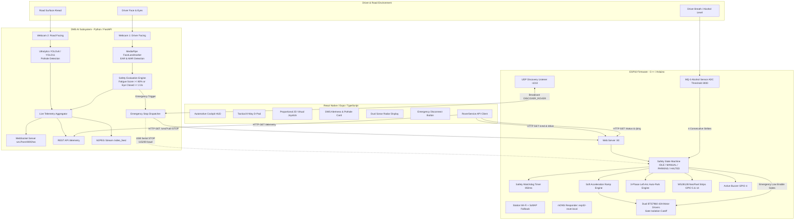

# System Architecture: Smart Driver Assistance System

## 1. High-Level System Overview

The **Smart Driver Assistance System** is an integrated safety and robotics platform designed to prevent vehicular accidents caused by driver impairment, drowsiness, and road hazards. The system combines real-time edge processing on an **ESP32 microcontroller**, computer vision and deep learning on a companion **laptop/edge computer**, and a touch-optimized **React Native Expo mobile cockpit**.



---

## 2. Component Responsibilities

The monorepo is divided into three primary functional components and an experimental prototype archive:

```
Smart-Driver-Assistance-System/
├── firmware/         # Component 1: Embedded Real-Time Vehicle Controller
├── dms_ai/           # Component 2: AI Driver Monitoring & Road Hazard Vision
├── mobile_app/       # Component 3: React Native Expo Mobile Cockpit HUD
└── prototypes/       # Archival & Early Standalone Vision Research
```

### Component 1: ESP32 Rover Firmware (`firmware/`)
The ESP32 microcontroller acts as the central safety controller and physical actuator hub.
* **Motor Drive Architecture**: Controls two independent BTS7960 high-current H-bridges using 4 PWM channels (5 kHz, 8-bit resolution) and 4 enable lines (`L_REN`, `L_LEN`, `R_REN`, `R_LEN`).
* **Gate Isolation Emergency Cutoff**: Floats the MOSFET gates instantly by setting all four enable lines `LOW`. This physically prevents motor drive even if PWM signals are present.
* **Alcohol Ignition Lockout**: Continuously samples the analog MQ-3 gas sensor on GPIO 34. Implements noise filtering using an exponential moving average (`(current * 2 + raw) / 3`) and a 4-strike consecutive threshold debounce (`ALCOHOL_THRESH = 3000`). If triggered, the ignition is locked, buzzer sounds, and motor drive is completely disabled.
* **3-Phase Auto-Parking Engine**: When emergency microsleep is detected (`STOP` or `PARK` command received), the rover enters `STATE_PARKING` and executes an autonomous safety trajectory:
  1. *Phase 1 (0 – 1600ms)*: Sweeping left arc towards the curb (`targetLeft = -135`, `targetRight = -33`).
  2. *Phase 2 (1600 – 2600ms)*: Straightening reverse trajectory parallel to the curb (`targetLeft = targetRight = -81`).
  3. *Phase 3 (2600 – 3200ms)*: Soft deceleration to a complete halt.
  4. *Lockout*: Transitions to `STATE_HALTED` with MOSFET gates floated until explicitly cleared by driver re-arm (`S` command).
* **Communication & Telemetry**: Hosts an HTTP server on port 80, an mDNS responder (`esp32-rover.local`), and a UDP listener on port 4210 for automatic local network discovery.
* **Watchdog Safety Guard**: Automatically halts motors if no drive heartbeat is received within 850ms during manual driving.

### Component 2: AI Driver Monitoring System (`dms_ai/`)
Runs on an external computer equipped with cameras to evaluate driver vigilance and road conditions.
* **Facial Analysis (MediaPipe FaceLandmarker)**: Analyzes facial landmarks in real-time. Calculates eyelid vertical separation and eye aspect ratios (EAR) to detect prolonged eye closure, as well as mouth aspect ratios (MAR) to detect yawning.
* **Microsleep Evaluation**: Employs dual-stage temporal filtering:
  - Eye closure $\ge 1.0\text{s}$: Warning stage.
  - Eye closure $\ge 2.0\text{s}$ or Fatigue Index $\ge 80\%$: Critical microsleep emergency trigger.
* **Road Hazard Detection (YOLO)**: Employs custom-trained YOLO weights (`pothole_best.pt`) alongside YOLO11 nano (`yolo11n.pt`) to detect potholes and surface anomalies.
* **Dual Emergency Dispatch**: Dispatches `val=STOP` simultaneously over HTTP to `http://esp32-rover.local/cmd?val=STOP` and over USB Serial (`STOP\n`) to guarantee vehicle intervention even if Wi-Fi packets drop.
* **Telemetry Streaming**: Hosts a FastAPI server on port 8000 exposing `/telemetry`, `/video_feed` (MJPEG), and `/ws` (WebSocket) with full CORS support.

### Component 3: React Native Mobile Cockpit (`mobile_app/`)
Provides a responsive touch dashboard designed for real-time manual control and telemetry monitoring.
* **Dual Control Schemes**:
  - *8-Way Tactical D-Pad*: Discrete direction control (Forward, Backward, Left, Right, Forward-Left, Forward-Right, Backward-Left, Backward-Right) with continuous heartbeat transmission.
  - *2D Virtual Joystick*: Continuous touch vector calculation using React Native `PanResponder`. Converts $X/Y$ coordinates into differential PWM values for natural steering.
* **Telemetry HUD**: Displays real-time latency ping, front/left sonar bars, vehicle state badges, and live AI driver alertness scores streamed from the DMS AI server.
* **Safety Controls**: Dedicated Tyre Disconnect emergency stop button, speed preset selector (`ECO` 120, `MID` 185, `SPORT` 250), and one-touch Re-Arm trigger.
* **Offline Simulation Mode**: Built-in simulator for testing UI interactions, animations, and failsafes without requiring physical hardware.

---

## 3. Communication Protocols & Network Topologies

```
┌───────────────────────────────────────────────────────────────┐
│                      Common Local Network                     │
│               (Wi-Fi Router or Mobile Hotspot)                │
│                                                               │
│   ┌─────────────────────┐             ┌───────────────────┐   │
│   │    ESP32 Rover      │             │    Companion AI   │   │
│   │  esp32-rover.local  │◄────────────│      Computer     │   │
│   │   192.168.x.x:80    │  HTTP /cmd  │   192.168.x.y:8000│   │
│   └──────────┬──────────┘             └─────────┬─────────┘   │
│              ▲                                  ▲             │
│              │ HTTP /drive, /status             │ /telemetry  │
│              │                                  │             │
│              └────────────┐       ┌─────────────┘             │
│                           │       │                           │
│                     ┌─────┴───────┴─────┐                     │
│                     │   Mobile Cockpit  │                     │
│                     │  (Expo / React)   │                     │
│                     └───────────────────┘                     │
└───────────────────────────────────────────────────────────────┘
```

### 1. Network Auto-Discovery (UDP 4210)
To avoid manual IP configuration when DHCP assigns dynamic addresses:
1. The companion computer or mobile app broadcasts a UDP datagram `DISCOVER_ROVER` to `<broadcast>:4210`.
2. The ESP32 `WiFiUDP` listener receives the packet and replies with:
   ```text
   ROVER_HERE:http://192.168.x.x
   ```
3. The sender extracts the IP and configures its HTTP client dynamically.

### 2. ESP32 RESTful Control Endpoints (HTTP Port 80)

| Endpoint | Method | Parameters | Description |
| :--- | :--- | :--- | :--- |
| `/ping` | `GET` | None | Returns `{"pong":true}` for round-trip latency measurement |
| `/status` | `GET` | None | Returns JSON telemetry (distances, state, alcohol ADC, motor PWM) |
| `/cmd` | `GET`, `POST` | `val=<F\|B\|L\|R\|FL\|FR\|BL\|BR\|S\|STOP\|SLEEP\|PARK>`, `spd=<50-255>` | Executes directional commands or initiates emergency stop |
| `/drive` | `GET`, `POST` | `left=<-255..255>`, `right=<-255..255>` | Sets differential PWM for 2D joystick steering |
| `/settings` | `GET` | `speed=<int>`, `turn=<int>`, `brake=<0\|1>`, `watchdog=<ms>` | Dynamically adjusts motion limits and safety watchdog |
| `/` | `GET` | None | Serves standalone embedded HTML5 web cockpit |

All HTTP endpoints include headers `Access-Control-Allow-Origin: *` and respond to `OPTIONS` preflight requests to support browser and React Native fetch operations.

### 3. USB Serial Protocol (115200 Baud)
When tethered via USB cable, the ESP32 listens on `Serial` for newline-terminated ASCII commands:
* `STOP`, `SLEEP`, `PARK`: Triggers immediate 3-phase auto-parking and lockout.
* `ARM`, `RESET`, `RESTORE`, `RESUME`: Re-arms the system after an alarm condition clears.

---

## 4. Hardware Verification & Implementation Reality Check

To uphold strict technical integrity, the following matrix contrasts documented intentions with actual source code verification:

| Feature / Subsystem | Documented Spec | Actual Implementation in Code | Verification Status |
| :--- | :--- | :--- | :--- |
| **BTS7960 Motor Drivers** | Dual 43A H-bridges | 4 PWM channels + 4 enable lines on GPIO 18, 19, 21, 22, 23, 25, 27, 32 | **VERIFIED** |
| **Gate Isolation Cutoff** | Floats MOSFET gates | Sets all 4 enable pins `LOW` on stop/halt | **VERIFIED** |
| **MQ-3 Alcohol Sensor** | Ignition lockout | Analog read on GPIO 34, moving average, 4-strike counter $\ge 3000$ | **VERIFIED** |
| **Buzzer Alarm** | Audio alert on alcohol | Active buzzer on GPIO 4 | **VERIFIED** |
| **WS2812B NeoPixel Strips** | Status indication | 20 LEDs on GPIO 5, 8 LEDs on GPIO 14 | **VERIFIED** |
| **3-Phase Auto-Parking** | Arc to curb on microsleep | Time-staged trajectory in `STATE_PARKING` | **VERIFIED** |
| **Safety Watchdog** | Halts on Wi-Fi loss | 850ms timeout resets `STATE_MANUAL` to `STATE_IDLE` | **VERIFIED** |
| **MediaPipe Eye/Yawn DMS** | AI vigilance tracking | MediaPipe FaceLandmarker with EAR/MAR threshold logic | **VERIFIED** |
| **YOLO Pothole Detector** | Road hazard detection | Ultralytics YOLO inference with `pothole_best.pt` | **VERIFIED** |
| **Dual Control (D-Pad & Joystick)** | Mobile touch controls | Tactile D-Pad & PanResponder differential drive math | **VERIFIED** |
| **Ultrasonic Sonar Hardware Reads** | HC-SR04 Front & Left | Variables `frontDist` and `leftDist` initialized to 200 cm; pulse timing routine is not active in current firmware iteration (GPIO 4 is assigned to Buzzer) | **CODE STUB / MOCKED IN TELEMETRY** |
